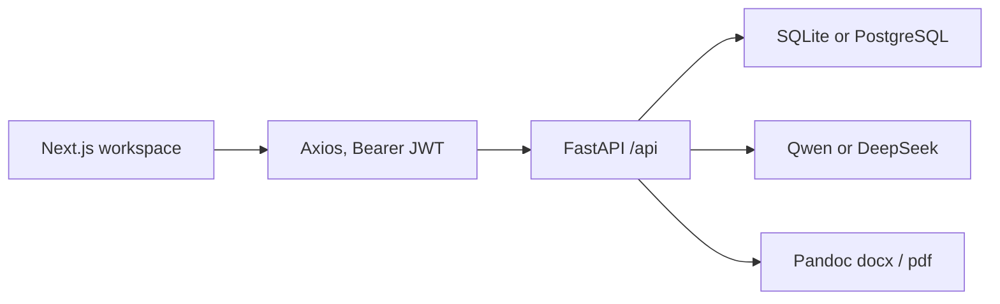

# DocFlow (文流)

DocFlow is a Chinese-language AI writing workspace. You chat with a model, drop the answer into a rich-text editor, and export the document to Word. The interesting frontend work is a TipTap editor that treats LaTeX as a real node, plus a split workspace that keeps streaming chat and the document on one screen.

The interface copy is Simplified Chinese. This README is in English so the project can be read without opening the source.

## Tech stack

| Area | Choice |
| --- | --- |
| App | Next.js 14 (App Router), React 18, TypeScript |
| Editor | TipTap 3, `tiptap-markdown`, custom KaTeX node, MathLive formula dialog |
| UI | Tailwind CSS, Radix UI primitives, Framer Motion, Lucide, Sonner |
| Client data | Zustand stores, Axios with a JWT interceptor, TanStack Query provider |
| Rendering | `react-markdown`, remark-gfm, remark-math, rehype-katex, highlight.js |
| API | FastAPI, Pydantic Settings, slowapi |
| Data | SQLAlchemy 2 async, SQLite in development, PostgreSQL (`asyncpg`) in production, Alembic |
| Auth | Phone + password or SMS code, bcrypt hashes, JWT (`python-jose`) |
| AI | Qwen (DashScope compatible-mode) and DeepSeek, selected by `API_MODE` |
| Export | Pandoc to `.docx` (OMML math) and PDF; Mermaid blocks rendered to PNG when `mmdc` is installed |

Versions are pinned in [`frontend/package.json`](frontend/package.json) and [`backend/requirements.txt`](backend/requirements.txt).

## What you can actually try

These behaviors are wired from the current pages to the API.

- **Phone auth.** [`/login`](frontend/app/(auth)/login/page.tsx), [`/register`](frontend/app/(auth)/register/page.tsx), and [`/forgot-password`](frontend/app/(auth)/forgot-password/page.tsx) call `/api/auth/*`. Password login does not need SMS. With Aliyun SMS left empty, [`sms_service.py`](backend/app/services/sms_service.py) still accepts the send and writes the code to the API log, so local registration works.
- **Workspace shell.** [`/workspace`](frontend/app/(dashboard)/workspace/page.tsx) waits for `GET /api/auth/me`, then renders a fixed full-viewport layout: streaming chat on the left, TipTap on the right, membership button and user menu in the header.
- **Chat to editor.** [`WorkspaceChat.tsx`](frontend/components/workspace/WorkspaceChat.tsx) streams `POST /api/ai/chat/stream`, renders Markdown with GFM, math, and code highlighting, and copies the finished answer into the editor store. The model list in the UI is Qwen Turbo; the API also advertises Qwen Plus/Max and DeepSeek V3/R1.
- **Word upload.** The same chat panel uploads a `.docx` to `POST /api/editor/parse-docx` and loads the returned text into the editor.
- **Rich text.** The toolbar covers headings, bold, italic, underline, strike, lists, quote, code, tables, and images. Pasted Markdown is normalized, including `\[...\]` and `\(...\)` math from Doubao and DeepSeek, before TipTap parses it.
- **Formulas.** [`KaTeXNode.tsx`](frontend/components/workspace/editor/extensions/KaTeXNode.tsx) is a TipTap node with its own Markdown tokenizer. Clicking a formula opens [`MathFormulaDialog.tsx`](frontend/components/workspace/editor/MathFormulaDialog.tsx).
- **Selection rewrite.** Selecting text shows a floating toolbar (rewrite, expand, shorten, polish, tone, translate). It calls `POST /api/ai/rewrite` and replaces the selection.
- **Word export.** The toolbar button sends the editor Markdown to `POST /api/export/docx`. The backend runs Pandoc with `tex_math_dollars`, maps Mermaid fences to PNG when the CLI exists, and can apply `default`, `academic`, `business`, or `simple` reference docs.
- **Membership UI.** The header opens an upgrade modal with monthly, annual, and lifetime plans plus a balance top-up. Prices are recomputed on the server. WeChat, Alipay, and a mock channel are implemented. Mock checkout is available only when `DEBUG=true` and `ENABLE_MOCK_PAYMENT=true`.

### Present in code, not on the current screen

- Document save, list, load, and delete (`/api/editor/document*`) and the `useDocument` / `useEditor` hooks. The workspace page does not mount them, and [`WorkspaceSidebar.tsx`](frontend/components/workspace/WorkspaceSidebar.tsx) is unused.
- PDF export (`POST /api/export/pdf`) via wkhtmltopdf, then WeasyPrint. The PDF toolbar button is commented out.
- Image upload, LaTeX validate/render, and table-of-contents endpoints under `/api/editor`.
- Quota, orders, and conversion-record endpoints under `/api/user` and `/api/records`.

### Not finished

Do not describe these as shipped.

- `POST /api/export/excel` and `POST /api/export/image` return HTTP 501.
- [`/tools/markdown-to-word`](frontend/app/(public)/tools/markdown-to-word/page.tsx) and [`/tools/markdown-to-pdf`](frontend/app/(public)/tools/markdown-to-pdf/page.tsx) render marketing copy around a placeholder that says the editor is not built yet.
- The navbar and tools index link to `/editor`, `/prompts`, and several `/tools/*` routes that have no `page.tsx`.
- [`/pay/result`](frontend/app/pay/result/page.tsx) is a stub.
- [`/`](frontend/app/(public)/page.tsx) immediately redirects to `/workspace`, which redirects anonymous visitors to `/login`.

## Run locally

Use two terminals. Node 20+ and Python 3.11+ are enough for the UI and API. Word and PDF export also need Pandoc on `PATH`.

### Frontend

```bash
cd frontend
cp .env.example .env.local
npm install
npm run dev
```

Open [http://localhost:3000/login](http://localhost:3000/login). Other scripts: `npm run lint`, `npm run type-check`, `npm run build` (static export, lint skipped, TypeScript errors ignored in [`next.config.mjs`](frontend/next.config.mjs)).

### Backend

```bash
cd backend
python -m venv .venv
source .venv/bin/activate   # Windows: .venv\Scripts\activate
pip install -r requirements.txt
cp .env.example .env
```

Set `SECRET_KEY` in `backend/.env` to a long random string before you keep any real account. Leave SMS, WeChat, Alipay, and AI keys empty until you need them.

```bash
uvicorn app.main:app --reload --host 0.0.0.0 --port 8000
```

Port **8000** matches `NEXT_PUBLIC_API_URL_DEV`. `app/config.py` defaults `PORT` to 8001, but the process port is whatever you pass to Uvicorn.

| URL | What it is |
| --- | --- |
| http://localhost:8000/health | Liveness |
| http://localhost:8000/docs | OpenAPI |

Development startup creates tables when `DEBUG` is true (`init_db` in [`backend/app/database.py`](backend/app/database.py)). For a migrated Postgres database, use Alembic (`alembic upgrade head`).

Optional export tools, from comments in `backend/requirements.txt`:

- Pandoc 3+ for `.docx` and PDF
- wkhtmltopdf, preferred PDF engine, or WeasyPrint
- `@mermaid-js/mermaid-cli` (`mmdc`) if diagrams should become images inside the file

Redis is configured by `REDIS_URL` but the checked-in limiter is in-memory slowapi. The app starts without Redis.

## Environment

Secrets stay in untracked `.env` files. Examples:

- [`frontend/.env.example`](frontend/.env.example) — public site URL and the dev API origin
- [`backend/.env.example`](backend/.env.example) — database, JWT, CORS, and empty slots for SMS, payments, and model keys

```bash
cp frontend/.env.example frontend/.env.local
cp backend/.env.example backend/.env
```

Nothing in those examples is a live credential. `SECRET_KEY` is a placeholder and must be replaced. Do not commit `.env`, `*.pem`, or `backend/certs/`.

When Aliyun SMS is unset, the API logs each verification code. That is only for local development.

## Project structure

```text
frontend/
  app/
    (auth)/                 login, register, forgot password
    (dashboard)/workspace/  authenticated editor shell
    (public)/tools/         marketing pages; editor slot is a placeholder
    pay/result/             stub
  components/workspace/     chat, editor, toolbar, formula dialog
  hooks/                    AI, export, documents (documents are not mounted)
  lib/api/                  Axios clients
  store/                    auth, editor, AI (Zustand)
backend/
  app/main.py               router registration, CORS, /assets
  app/routers/              auth, ai, editor, export, payment, user, records
  app/services/             AI providers, Pandoc export, SMS, payment channels
  app/models/               users, documents, orders, records, SMS codes
  alembic/                  billing migration
```

The Chinese notes in [`backend/README.md`](backend/README.md) and [`backend/BACKEND_PROGRESS.md`](backend/BACKEND_PROGRESS.md) describe an older snapshot. Prefer this file and the source.

## Architecture



- **Production path.** [`next.config.mjs`](frontend/next.config.mjs) sets `basePath` to `/docFlow` and `output: 'export'`. The browser then calls same-origin `/docFlow`, not `NEXT_PUBLIC_API_URL_DEV`. The dev rewrite of `/api/*` to `BACKEND_URL` does not apply to that static export, so production hosting has to route `/docFlow/api` itself.
- **Auth.** Access tokens live in `localStorage` under `token`. The Axios interceptor attaches `Authorization: Bearer`. `/workspace` clears the token when `/api/auth/me` fails.
- **Editor state.** Zustand holds the Markdown/HTML string the chat panel writes and the editor reads. TipTap owns the document model; the KaTeX node serializes math back to `$` / `$$` so export still sees Markdown.
- **Export.** [`export_service.py`](backend/app/services/export_service.py) shells out to Pandoc. Math becomes OMML in Word. PDF tries wkhtmltopdf, then WeasyPrint, and injects a CJK font stack. Export records a quota check for logged-in users.
- **Payments.** Channel classes register WeChat, Alipay, and mock. The server, not the modal, decides the charged amount.

## Screenshots

The app was started locally for this README. Shots below are the routes that render without extra accounts or paid APIs. Captures use a 1440×900 desktop viewport.

| Screen | File |
| --- | --- |
| Login, password and SMS | [`docs/screenshots/login.png`](docs/screenshots/login.png) |
| Register | [`docs/screenshots/register.png`](docs/screenshots/register.png) |
| Format-conversion index | [`docs/screenshots/tools.png`](docs/screenshots/tools.png) |
| Markdown-to-Word page, editor slot still a placeholder | [`docs/screenshots/markdown-to-word.png`](docs/screenshots/markdown-to-word.png) |

Still worth capturing after you sign in with the API running:

1. `/workspace` with a streamed answer on the left and the same text in the editor.
2. A selected sentence with the floating rewrite toolbar open.
3. The formula dialog on a display equation.
4. The membership modal on top of the editor.

There is no committed shot of those states. They need a logged-in session and, for a real answer, `QWEN_API_KEY` or `DEEPSEEK_API_KEY`.
